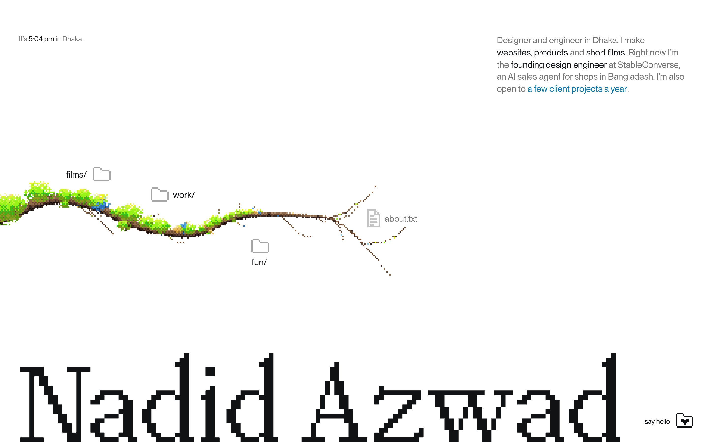

# garden

I'm Nadid Azwad, a designer and engineer in Dhaka. This is my portfolio. My work sits in a file tree, and the tree grows as a plant. Open a folder and a branch grows out of it. Open a file and you get the thing I made.



I make websites, products and short films, mostly for businesses here: a Hajj agency, a publishing house, a startup selling over Messenger. Right now I'm the founding design engineer at StableConverse, an AI sales agent for shops in Bangladesh.

## How it's made

- **The plant** started as a screen recording of a file tree growing like a vine. I rebuilt it from nothing in three.js: lit tubes and leaves, dithered onto a pixel grid that's locked to the world, so the pattern never crawls when you drag. The icons sit on the same grid, one icon pixel to a dither cell.
- **The tree** (`src/grove/`) doesn't know three.js exists. It owns the growing, what's open and the camera, and the plant and the labels both read from it, so they move in the same frame.
- **The case studies** are Markdown in `src/portfolio/writing/`, written in a small dialect of my own for deliverables, before/after sliders, drifting strips and numbers. `src/garden/case/parse.ts` lists the shapes.
- **The sound** is made with [earshot](https://github.com/Leonxlnx/earshot), all of it rendered from code rather than recorded: a two-second welcome on kalimba, marimba and a bell, then cues that come from what the plant does. A folder knocks open on wood, each name that sprouts rings a marimba note a step higher than the last, and a branch knocks shut, each one heard from where it is on screen. Browsers keep a page silent until it's touched, so the welcome plays as the page lands where that's allowed, and on the first click everywhere else. The script that makes them lives outside this repo; what it makes is in `public/sound/`.
- **The motion** stays on the pixel grid where it can: icons lift on hover and press flat into the page by exactly one pixel, and names grow out of their icons as the plant reaches them.
- **The phone** gets a layout of its own. I placed it by hand in an editor that only runs in dev, at `/__overview/phone`.
- **Share cards**: a link to the garden previews as the garden itself, and a link to a case study as that case study, with its own title, summary and card. The build writes a page per case study from its Markdown (`src/meta/`). The favicon is a seedling glowing in a dusk sky, dithered like the plant and in its blues.
- **The screenshots and films** come from scripts that drive the live sites in a headless browser, filming them frame by frame and adding the camera moves. Those live outside this repo; what they make is in `public/media/`.

I build with AI agents. The taste, the direction and the final call are mine.

## Running it

```sh
pnpm install
pnpm dev      # http://localhost:5173
pnpm build    # fonts, typecheck, production build to dist/
pnpm test
```

The fonts (PP Neue Montreal, PP Mondwest and PP NeueBit, from Pangram Pangram) are licensed to my site, not to everyone who clones it, so they aren't here. Put your own copies in `public/fonts/`, or it runs on system fonts. My deploys pull them from a private repo.

## Licence

The code is MIT, so take whatever's useful. The work it shows isn't: the case studies and other writing in `src/portfolio/writing/`, the captions in `src/portfolio/tree.ts`, and the screenshots and films in `public/media/` are © Nadid Azwad and the clients they were made for, all rights reserved.

Type and layout after Finn Oliver Taylor.

[hello@nadidazwad.com](mailto:hello@nadidazwad.com) · [LinkedIn](https://www.linkedin.com/in/nadidazwad/) · [GitHub](https://github.com/nadidazwad) · X: a new account, soon

Live at [nadidazwad.com](https://nadidazwad.com).
